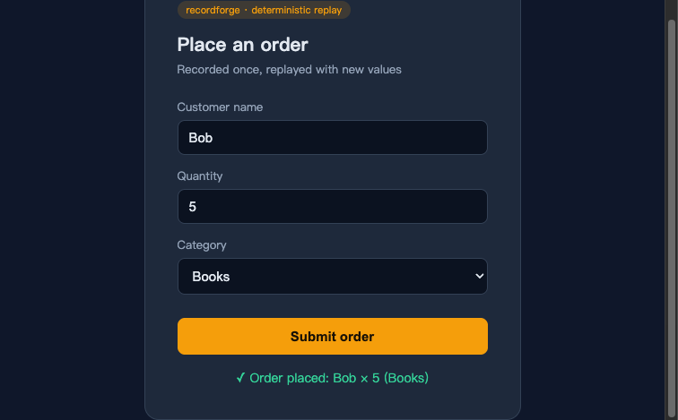

# RecordForge

Record browser workflows and replay them **deterministically**. RecordForge attaches to any Chromium-family browser over CDP, captures your real actions (clicks, typing, hovers, selects, scrolls, file uploads, context menus, navigation), compiles them into a deterministic replay script, and replays them with real input events — **no page re-reading and no LLM in the replay loop**.

It ships as an **MCP server** (drop into Claude Code, Codex, Hermes, Cline, or any MCP client) and a **CLI**.

```
record  ->  compile  ->  replay
```

<p align="center"></p>

<p align="center"></p>

## Why deterministic replay?

Most browser agents re-read the page and re-decide every step through the model. That is slow, non-deterministic, and burns tokens. RecordForge captures a workflow **once**, compiles it into a fixed script of `{op, finders, value, wait}` steps, and replays it in a single pass with a fixed locator strategy. A step either succeeds or stops with the exact step index and reason — never a guess.

## Features

- **Capture everything**: click, type, hover, select, scroll, file upload, context menu, Enter/submit, and navigation — across every frame in the tab (including dynamically created iframes).
- **Robust locators**: each element is located by a priority chain (stable id → class → name → data-testid → placeholder → aria-label → title → label → visible text → table column → structural path), with ordered fallbacks (`text:`, `xpath:`, CSS).
- **React / Ant Design aware**: transient state classes (`ant-*-open`, `-active`, `-hover`) and hash-prefixed dynamic ids are filtered at capture time; form fields are set through the native value setter so controlled components see the change.
- **Secrets never recorded**: `type=password` and `autocomplete`-sensitive fields (`current-password`, `new-password`, `one-time-code`, `cc-number`, `cc-csc`) are captured as a `{SECRET:name}` placeholder — the value never crosses the CDP boundary. Secrets are resolved at replay time from a local store, never written into the recording or the skill.
- **Business inputs parameterized**: every typed value becomes a `{{name}}` placeholder, so replaying never re-creates the exact record you demonstrated.
- **Post-navigation verification**: after each navigation the replay waits for the next step's element to appear instead of blindly clicking after a fixed delay.

## Install

The tool is **agent-agnostic**: install it once and every agent uses it the same way. The only per-agent part is the MCP wiring and where the emitted skill goes (see below).

**From npm** (once published):

```bash
npm install -g @anyforgex/recordforge
```

**From source**:

```bash
git clone https://github.com/anyforge/recordforge recordforge
cd recordforge
./install.sh          # npm install + npm link
```

Requires Node 18+ and a Chromium-family browser (Chrome, Chromium, Edge, Brave).

## Quick start (CLI)

```bash
# 1. Record — launches a fresh Chrome; do the workflow, then press Ctrl-C
recordforge record --name order-status

# 2. Compile the recording into a deterministic skill
recordforge compile ~/.recordforge/recordings/order-status-<timestamp>.json --name order-status

# 3. Replay, filling the parameterized values
recordforge replay ~/.recordforge/skills/order-status.json 金额=800 事由=出差
```

Or record against a browser you already have open:

```bash
# start Chrome with remote debugging
google-chrome --remote-debugging-port=9222 --user-data-dir=/tmp/rf-profile

# record the active tab
recordforge record --cdp http://127.0.0.1:9222 --name checkout
```

## MCP integration

Add `recordforge` as an MCP server and any MCP-capable agent discovers `record_start`, `record_stop`, `compile`, `replay`, `list`, and the `secret_*` tools. The `recordforge-mcp` command comes from `npm install -g @anyforgex/recordforge`; from a source checkout use `node /abs/path/to/recordforge/src/index.js`.

**Claude Code** (`.mcp.json` in your project, or `~/.claude.json`):

```json
{
  "mcpServers": {
    "recordforge": {
      "command": "recordforge-mcp"
    }
  }
}
```

**Codex** (`~/.codex/config.toml`):

```toml
[mcp_servers.recordforge]
command = "recordforge-mcp"
```

**Hermes**: `hermes mcp add recordforge -- recordforge-mcp`

The agent then drives the same flow through tools instead of a shell: `record_start` → (you do the workflow) → `record_stop` → `compile` → `replay`.

## How it works

| Stage | What happens |
|---|---|
| **record** | A self-contained capture script is injected into every frame over CDP. Steps stream to the host in real time through a CDP binding, so a click that navigates never loses its step. |
| **compile** | Deterministic, no LLM: captured steps are normalized, redundant submits dropped, every typed value parameterized, secrets routed to the store, and a replay script with ordered finders is emitted. A `learn_prompt` is also produced for the host agent to optionally enrich the description and variable names. |
| **replay** | The script runs in one pass over CDP: each step resolves its element through the injected finder runtime and dispatches a real mouse/keyboard event (or the native value setter for form fields). Stops on the first failure with the step index and reason. |

## Emit a portable Agent Skill

Compile a recording, then emit it as a **universal Agent Skill** — a `SKILL.md` (frontmatter `name` + `description`) loadable by any agent that implements the Agent Skills spec:

```bash
recordforge emit ~/.recordforge/skills/order-status.json --name order-status
```

The bundle contains `SKILL.md` (the skill), `skill.json` (the replay payload), and `README.md` (per-agent install + MCP wiring).

| Agent | SKILL.md install path | MCP wiring |
|---|---|---|
| Hermes | `~/.hermes/skills/<name>/` | `hermes mcp add recordforge -- recordforge-mcp` |
| Claude Code | `~/.claude/skills/<name>/` or `.claude/skills/<name>/` | `.mcp.json` |
| Codex | `[[skills.config]] path=...` in `~/.codex/config.toml` | `[mcp_servers.recordforge]` |
| Pi | `~/.pi/agent/skills/<name>/` or `.pi/skills/<name>/` | `pi mcp add recordforge -- recordforge-mcp` |
| OpenClaw | `~/.openclaw/workspace/skills/<name>/` | gateway settings |
| DeepSeek Harness (dsh) | native bundle in `dsh/` — `dsh plugin add ./dsh` | native tools |

## Install the usage skill

The repo ships a portable **"recordforge" usage skill** — [`skill/recordforge/SKILL.md`](skill/recordforge/SKILL.md) — that teaches an agent the recordforge workflow (record → compile → emit → replay, secrets, MCP). Install it into any agent that implements the Agent Skills spec:

| Agent | Install |
|---|---|
| Claude Code | copy to `~/.claude/skills/recordforge/` |
| Codex | reference via `[[skills.config]] path=...` in `~/.codex/config.toml` |
| Pi | copy to `~/.pi/agent/skills/recordforge/` |
| OpenClaw | copy to `~/.openclaw/workspace/skills/recordforge/` |
| Hermes | copy to `~/.hermes/skills/recordforge/` |

This is distinct from the skills `recordforge emit` generates — this one teaches *how to use* recordforge; `emit` turns *one recorded workflow* into a replayable skill.

## Secrets

Secrets live in a local store (`~/.recordforge/secrets.json`, mode 0600) and are resolved only at replay time, keyed by name:

```bash
recordforge secret set password     # prompts with input masked
recordforge secret list             # names only, values never printed
recordforge secret delete password
```

> **v1 note**: the store is a plaintext file, unencrypted, intended for one machine. An OS-keyring backend is planned. If you expose a secret to an agent through the MCP `secret_set` tool, that value necessarily transits the MCP channel — prefer the CLI masked prompt for secrets the agent must not see.

## Locator model

A recorded step carries one primary locator plus ordered fallbacks. Locator prefixes:

| Prefix | Meaning |
|---|---|
| `#id` | element id (hash-prefixed session ids are matched by their stable suffix) |
| `css` | CSS selector (prefers stable semantic classes over `:nth-of-type`) |
| `text:...` | visible text |
| `label:...` | associated `<label>` text |
| `col:...` | table column header |
| `xpath:...` | indexed XPath (iframe-relative) |
| `[name=]`, `[placeholder=]`, `[aria-label=]`, `[title=]` | attribute selectors |

## Limitations

- **Multi-tab**: supported — recording and replay span every tab, switched by URL. Two non-current tabs with the same URL are ambiguous and resolved by first match.
- **Iframes**: recorded and replayed; cross-origin iframe clicks fall back to a JS `click()` (CDP cannot compute coordinates across origins).
- **Coarse scroll**: window scrolling is captured as a step, not pixel-exact; scrolls inside nested scrollable elements are not captured.
- **Secret store is plaintext** (v2 will add an OS-keyring backend).
- **DeepSeek Harness plugin is untested** against a live dsh (developer preview).

## Development

```bash
npm test          # end-to-end record/compile/replay + MCP smoke test
node test/e2e.js  # live browser test (needs Chrome)
node test/mcp-smoke.js
```

## License

AGPL-3.0

## Sponsor

If recordforge helps you, consider sponsoring its development:

<div align="center">
  
  
</div>
